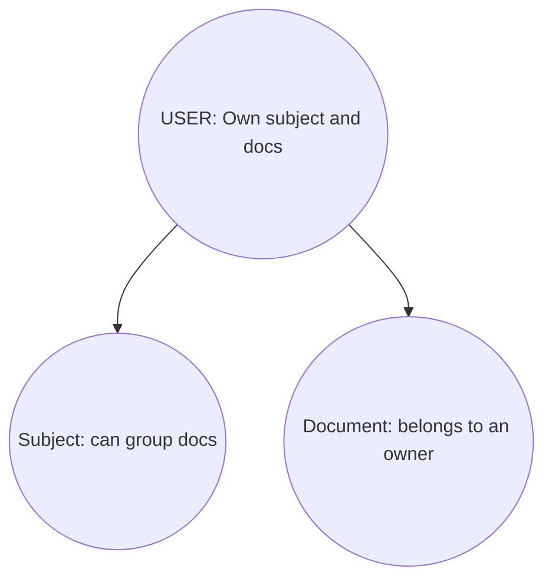
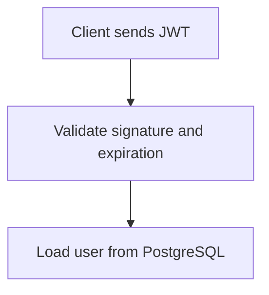

## Day 1: Progress

|**Package**|**Purpose**|
|-----------|-----------|
|fastapi|Build the API|
|uvicorn|Run the API server|
|sqlalchemy|Communicate with PostgreSQL|
|psycopg\[binary]|PostgreSQL database driver|
|pydantic-settings|Load configuration from environment variables|
|python-dotenv|Read .env files|

### Structure
- core/config.py — application settings.
- db/database.py — PostgreSQL connection and SQLAlchemy setup.
- .env — private configuration, including the database password.
- main.py — FastAPI application entry point.

## Day 2: Progress
- app/model/user

|**Code**|**Purpose**|
|-----------|-----------|
|class User(Base)|Maps the Python class to a database table|
|__tablename__ = "users"|Sets the PostgreSQL table name|
|id|Unique identifier for each user|
|email|Required email address; duplicates aren't allowed|
|password_hash|Stores a password hash, never the plain-text password|

- Foreign keys enforce connections in the database. SQLAlchemy's relationship() lets Python navigate between related objects.

## Day 3: Progress

## Day 4: Progress

